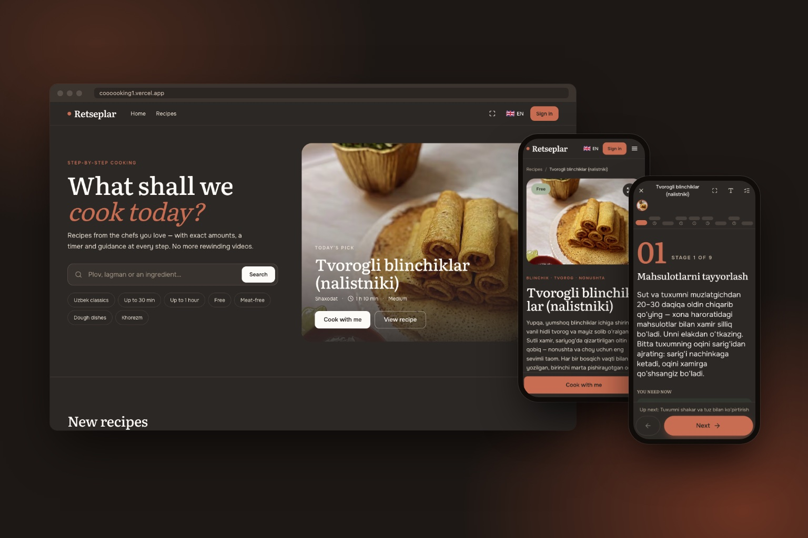
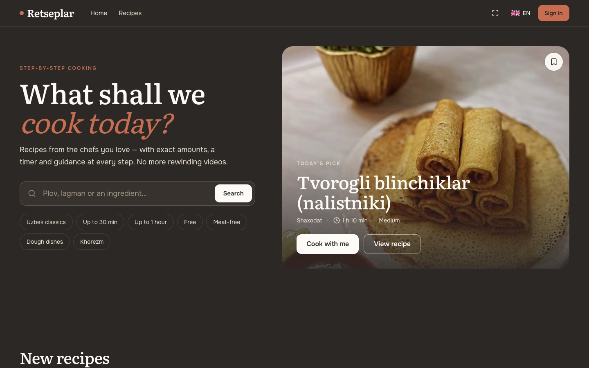
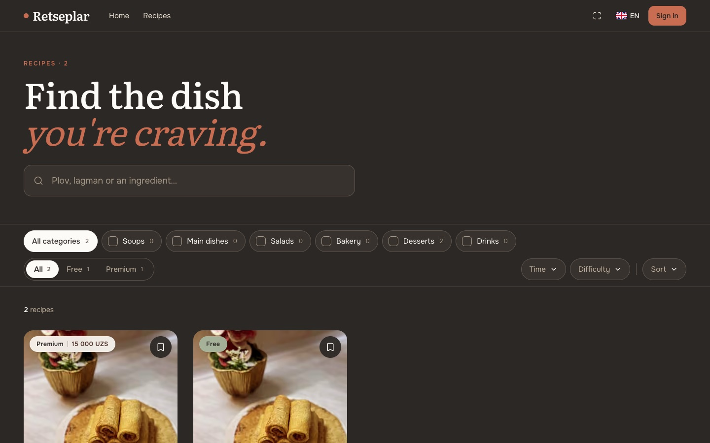
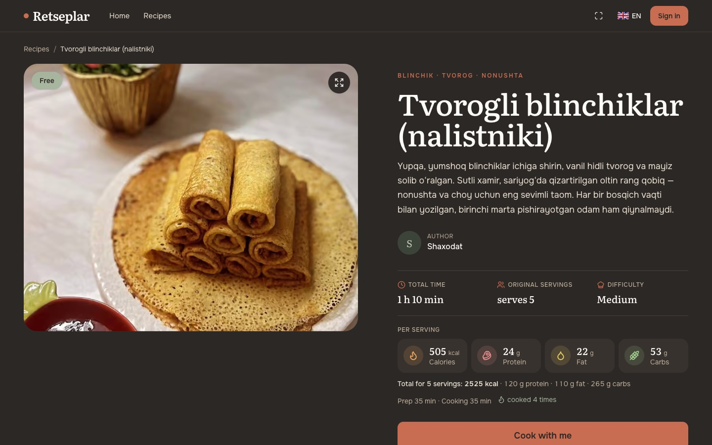
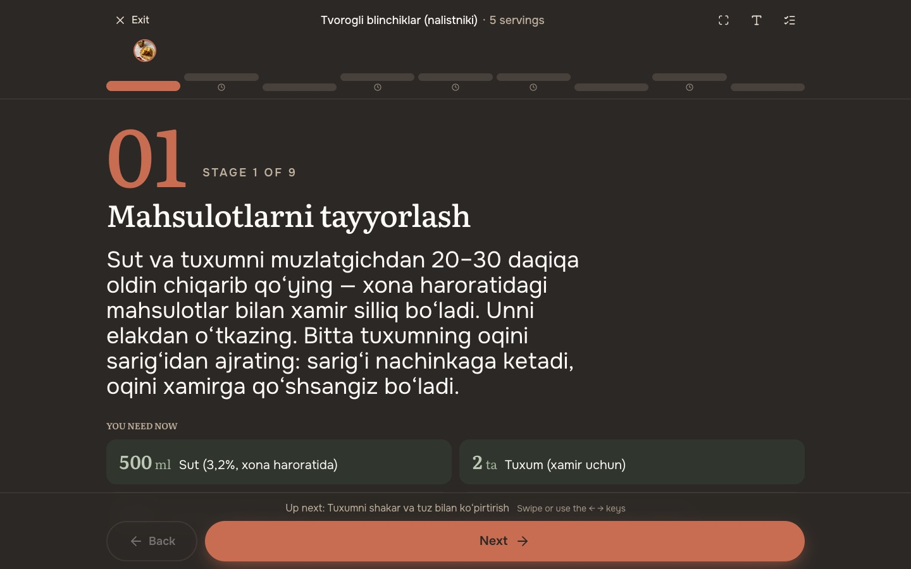
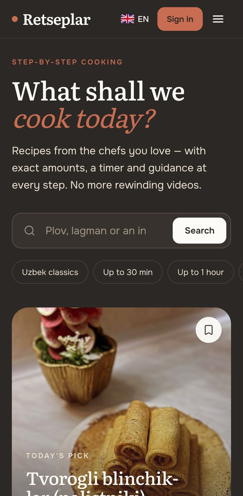
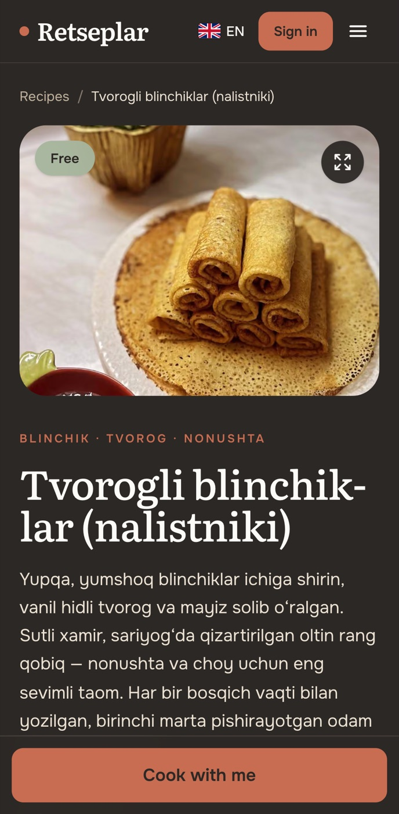
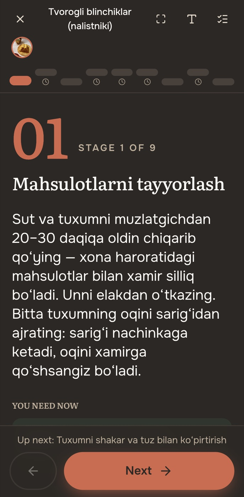

# Retseplar 🍳

**Step-by-step recipes from the chefs you love. No more rewinding YouTube while your hands are covered in flour.**

[**Live app →**](https://coooooking1.vercel.app) &nbsp;·&nbsp; Uzbek · Russian · English · Kazakh

> A startup I designed and built on my own. It is **live in production** and onboarding its first creators and users.



## The problem

In Uzbekistan most people learn to cook from Instagram reels and YouTube videos. Following one in a real
kitchen means pausing, rewinding and guessing amounts with messy hands. Home chefs who make great
content have no simple way to sell a proper, written recipe.

## What Retseplar does

**For home cooks**
- **Cook mode**: one step per screen in large type, with the exact ingredients needed for that step,
  built-in timers and "up next". Swipe or use the arrow keys. The screen stays awake (Wake Lock API).
- **Servings scaling**: amounts recalculate for the number of people.
- Search and filters (category, time, difficulty, free/premium) and nutrition per serving.
- Saved recipes, **cookbooks**, a **shopping list** built from recipes, and **photo reviews**.

**For creators**
- A studio to publish recipes with step photos and video clips, with ingredients and timers per step.
- **Premium recipes** with their own price. The buyer pays the creator directly, the platform takes
  **no commission**, and payment is unlocked by a secure order code (see below).
- **Promo codes** (percent off, fixed amount or free), plus sales, orders, reviews and stats dashboards.

**For the team**
- An admin panel for users, creators, recipes, purchases and analytics, behind a secret sign-in address.

## Screenshots

| Home | Recipes |
|---|---|
|  |  |
| **Recipe page** | **Cook mode** |
|  |  |

<p align="center">
  
  &nbsp;
  
  &nbsp;
  
</p>

## Engineering highlights

- **Next.js App Router with Server Components and Server Actions.** Data is read on the server and
  forms post to typed actions validated with **Zod**, so most pages ship little client JavaScript.
- **PostgreSQL (Neon) + Drizzle ORM**: about 26 tables (users, creators, recipes, steps, ingredients,
  media, cookbooks, shopping lists, reviews, orders, promo codes, analytics…) with 18 versioned migrations.
- **Private media on Cloudflare R2.** Uploads go straight from the browser to R2 using **presigned URLs**,
  and files are served through short-lived signed links, so nothing in the bucket is public.
- **Payment unlocking without trusting chat messages.** "Buy" opens the creator's Telegram chat with
  a ready message and an order code like `DM-7K4Q2P` (ambiguous characters removed). Only the
  creator's confirmation in their dashboard unlocks the recipe. Orders expire after 72 hours and each
  buyer can have at most 5 open orders.
- **Auth from scratch**: phone or email sign-in, **bcrypt** password hashes, database sessions,
  email codes for password reset with a daily sending limit as a cost guard, and roles for admin and creator.
- **i18n** in 4 languages with a script that checks every language file has every key (`scripts/check-i18n.ts`).
- SEO: generated `sitemap.xml` and `robots.txt`, plus per-recipe metadata.

## Tech

**Next.js 16** · **React 19** · **TypeScript** · **Tailwind CSS 4** · **PostgreSQL (Neon)** · **Drizzle ORM** ·
**Zod** · **Cloudflare R2** (S3 API) · **Nodemailer** · **Radix UI** · **Vercel** (Frankfurt region)

## Run it locally

```bash
npm install
cp .env.example .env.local      # database, R2, email; every value is explained in the file
npm run db:migrate              # create the tables
npm run create-user && npm run make-admin
npm run dev
```

## Built by

**[Abdurashid Fattokhov](https://afa06.github.io/My_Portfolio/)**: product, design and all of the code.

- 73 commits between 7 Oct and 18 Nov 2026, all by me, in a private development repository
- About 18,700 lines of TypeScript
- This public repository is a clean copy of that code without its history, so that no credentials are published

Development continues privately, and this copy is updated from time to time.
